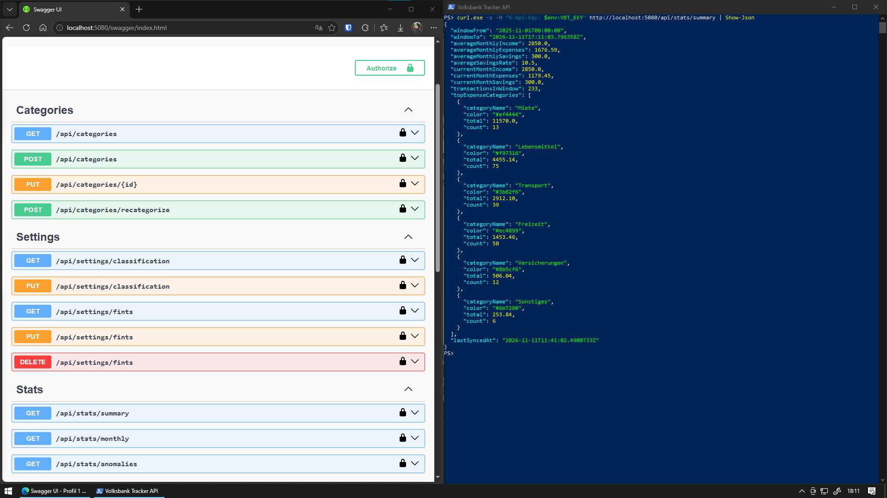
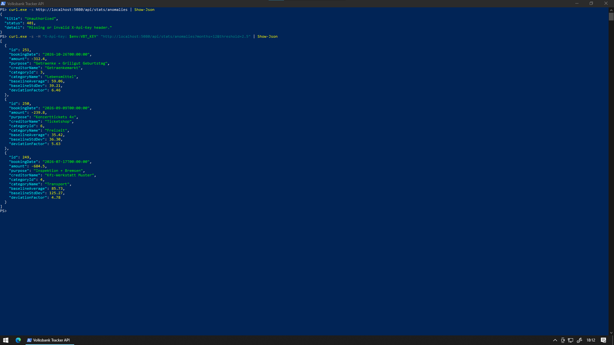

# Volksbank-Tracker-Api

A REST API wrapper for accessing Volksbank online banking data via the FinTS protocol using standard Onlinebanking login credentials. Syncs transactions into SQLite or Postgres, auto-categorizes them, and exposes stats/anomaly endpoints.

<p align="center">
  
</p>

## Why

I wanted statistics over my own bank account without handing my online-banking login to a third-party aggregator. FinTS is the protocol German banks already offer to finance software, so this API talks to the bank directly and keeps the data on my own server.

**What was hard**

- FinTS behaves differently per bank and version. TAN handling depends on the HITANS segment the bank announces, and the transaction download moved from MT940 (HKKAZ) to CAMT.052 (HKCAZ), which the sync uses.
- Bank transactions carry no stable ID, so each one is identified by a hash of its fields. That makes a repeated sync idempotent instead of creating duplicates.
- A wrong PIN repeated a few times locks the bank account, so credentials are checked against the bank before they are stored and the bank-facing endpoints are rate-limited.

**Trade-offs**

- Bank parameter data (BPD) is fetched again on every connection instead of cached: one extra round trip per sync, but never stale parameters after the bank changes them.
- SQLite by default for a single-user setup, Postgres when it runs next to other services. The price is two migration sets that have to stay in step, and the tests run against both.

<p align="center">
  
</p>

## Stack

- .NET 10, ASP.NET Core Web API
- EF Core with SQLite or Postgres (`AppDbContext`, code-first migrations per provider)
- Swagger/OpenAPI (Development only)

## Project layout

- `src/VolksbankTracker.API` — controllers, DTOs, middleware, `Program.cs`, the `copy-sqlite-to-postgres` command
- `src/VolksbankTracker.Core` — EF Core data layer, services (FinTS sync, categorization, stats, anomaly detection)
- `src/VolksbankTracker.Migrations.Sqlite`, `src/VolksbankTracker.Migrations.Postgres` — one migration set per provider
- `tests/VolksbankTracker.Tests` — API and copy tests, run against both providers

## Configuration

Only the host-level settings below live in configuration (`appsettings.json`, environment variables, or `dotnet user-secrets`). Everything else — FinTS credentials and the classification lists — is set exclusively through the API and stored in the database; there is no configuration fallback for them.

### `Api:Key`

Static API key required in the `X-Api-Key` header on every request. Must be set outside Development (startup throws otherwise). Requests without a matching key get `401`. This one cannot move into the database: it guards the endpoints that configure everything else.

### `DataProtection:KeysPath`

Directory for the ASP.NET Core Data Protection key ring that encrypts the stored FinTS credentials. Optional — defaults to the framework location (Windows: `%LOCALAPPDATA%\ASP.NET\DataProtection-Keys`, DPAPI-protected). Keep it outside the database folder, so a copy of the database alone does not expose the credentials. In Docker, mount it as a volume: if the key ring is lost, stored credentials become unreadable (`503`) and must be submitted again.

### `DB_PROVIDER`

`sqlite` (default) or `postgres`. Any other value stops startup.

### `ConnectionStrings:Default`

SQLite connection string, used when `DB_PROVIDER=sqlite`. Defaults to `Data Source=tracker.db`; the Docker image sets `/data/tracker.db`.

### `ConnectionStrings:Postgres`

Postgres connection string, required when `DB_PROVIDER=postgres`. All tables and `__EFMigrationsHistory` live in the `volksbank` schema, so the database can be shared with other apps. The role needs to create that schema on first start, or own it if it already exists. See `deploy/.env.example`.

```
dotnet user-secrets set "Api:Key" "..."
```

## FinTS credentials

Submitted via `PUT /api/settings/fints` (`BankUrl`, `BlZ`, `Iban`, `UserId`, `Pin` required; `Bic`, `Account` optional). They are verified against the bank first and only stored — encrypted — if the bank accepts them. Endpoints under `/api/sync` return `503` until they are stored.

## Security

The API holds online-banking credentials, so it is built to run privately, for one user, behind your own network or reverse proxy.

**Threat model**

- Protects against: a copied or leaked database file, unauthenticated callers on the network, brute-forcing the API key, and a wrong PIN locking the bank account through repeated attempts.
- Does not protect against: an attacker with access to both the database and the key ring directory, or to the running host. Do not expose the API directly to the internet.

**Credentials at rest**

- FinTS credentials (including the PIN) are stored only after the bank accepts them, encrypted with ASP.NET Core Data Protection (purpose `VolksbankTracker.FinTsCredentials`).
- The PIN is never returned by the API; `GET /api/settings/fints` returns masked identifiers only.
- If the key ring cannot decrypt the stored value, the API reports `Unreadable` / `503` instead of failing silently, and the credentials must be submitted again.

**Key handling**

- The Data Protection key ring lives in `DataProtection:KeysPath`, separate from the database, so a database copy alone does not reveal the credentials.
- On Windows the key ring is additionally encrypted with DPAPI. On Linux and in Docker the key files are stored unencrypted, so restrict access to that volume to the container user.
- Losing the key ring makes the stored credentials unreadable; it does not expose them.

**Access control**

- Every endpoint except `GET /health` requires the `X-Api-Key` header, compared in constant time (`CryptographicOperations.FixedTimeEquals`). Outside Development the API refuses to start without a key.
- Bank calls are rate-limited: sync and balance share 1 request per 30 seconds, `PUT /api/settings/fints` allows 3 requests per 10 minutes.
- The Docker image runs as a non-root user.

## Running

```
dotnet run --project src/VolksbankTracker.API
```

Migrations apply automatically on startup. In Development, Swagger UI is available at `/swagger`.

Tests run against SQLite and against Postgres via Testcontainers, so Docker must be running:

```
dotnet test --project tests/VolksbankTracker.Tests
```

A model change needs a migration for each provider:

```
dotnet ef migrations add <Name> -p src/VolksbankTracker.Migrations.Sqlite -s src/VolksbankTracker.API -o Migrations
DB_PROVIDER=postgres ConnectionStrings__Postgres="Host=localhost" \
  dotnet ef migrations add <Name> -p src/VolksbankTracker.Migrations.Postgres -s src/VolksbankTracker.API -o Migrations
```

The Postgres command never connects; it only needs a connection string to pick the provider.

## Moving from SQLite to Postgres

`copy-sqlite-to-postgres` copies every row from `ConnectionStrings:Default` into `ConnectionStrings:Postgres`, keeping IDs. It applies the Postgres migrations itself and refuses a target that holds anything beyond the seeded categories. The stored FinTS credentials are copied as ciphertext, so keep the same Data Protection key ring (the `/data` volume).

```
docker compose stop api
docker compose run --rm -e ConnectionStrings__Postgres="..." api copy-sqlite-to-postgres
# set DB_PROVIDER=postgres and ConnectionStrings__Postgres in .env
docker compose up -d
```

`tracker.db` stays untouched in the volume; switching `DB_PROVIDER` back to `sqlite` returns to it.

## API

All endpoints except `GET /health` require `X-Api-Key` header (if `Api:Key` is configured).

### Sync — `/api/sync`
- `POST /` — sync transactions from the bank (`{ "fromDate": "..." }` optional body)
- `GET /balance` — current account balance
- `GET /logs` — last 20 sync log entries

`POST /` and `GET /balance` share a rate limit of 1 request per 30 seconds.

### Transactions — `/api/transactions`
- `GET /` — paged list; query: `page`, `pageSize` (max 200), `categoryId`, `search`, `type` (`income`/`expense`), `sortBy` (`date`/`amount`/`category`), `sortDir` (`asc`/`desc`)
- `PATCH /{id}/category` — assign a category; the IBAN (or name) → category mapping is learned for future syncs

### Categories — `/api/categories`
- `GET /` — list categories
- `POST /` — create a category (`{ "name", "color", "icon" }`); `409` if the name exists (case-insensitive)
- `PUT /{id}` — update name/color/icon
- `POST /recategorize` — re-run auto-categorization (learned mappings, else fallback category) on all transactions

### Stats — `/api/stats`
- `GET /summary` — averages over the last 12 completed months, current month totals, top expense categories, last sync
- `GET /monthly?months=24` — monthly breakdown (max 120)
- `GET /anomalies?months=12&threshold=2.5` — anomalous transactions

### Settings — `/api/settings`
- `GET /classification` — current classification settings
- `PUT /classification` — update classification settings
- `GET /fints` — credential status (`source`: `None`/`Database`/`Unreadable`); identifiers masked, PIN never returned
- `PUT /fints` — verify credentials against the bank and store them encrypted (`{ "bankUrl", "blZ", "iban", "userId", "pin", "bic", "account" }`); `422` if the bank rejects them. Rate-limited to 3 requests per 10 minutes — wrong PINs count toward the bank's lockout
- `DELETE /fints` — remove stored credentials

Errors follow RFC 7807 `ProblemDetails` (`502` bank communication failure, `503` FinTS not configured, `401` bad/missing API key).
